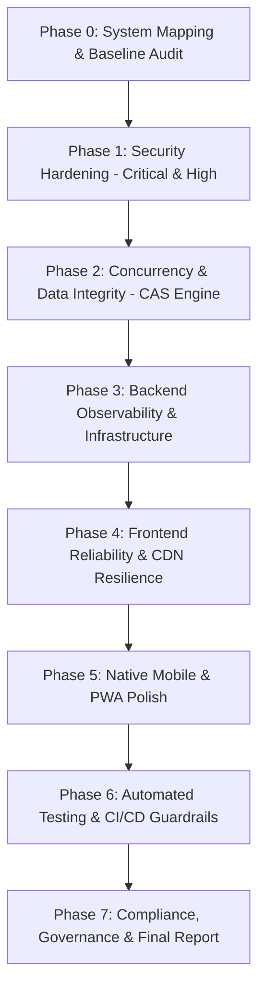

# Jawan Fitness — Remediation & Upgrade Execution Plan

**Objective**: Resolve all identified defects and vulnerabilities systematically by severity, adhering strictly to:
1. One fix per commit with verification.
2. Zero downtime and zero disruption to active authentication and sync logic.
3. Explicit migration and rollback procedures for any database schema or API alterations.

---

## Remediation Phasing & Order of Execution

---

## Detailed Remediation Work Packages

### Package 1: Security Hardening (Phase 1)
- [ ] **Fix SEC-01 (CORS Allowlist)**: Replace reflected Origin with strict domain allowlist in [`functions/api/auth.ts`](file:///c:/Users/yoges/.gemini/antigravity-ide/scratch/jawan-fitness-app/functions/api/auth.ts) and [`functions/api/sync.ts`](file:///c:/Users/yoges/.gemini/antigravity-ide/scratch/jawan-fitness-app/functions/api/sync.ts).
- [ ] **Fix SEC-08 (Security Headers & CSP)**: Create `public/_headers` with CSP (report-only initial mode), HSTS, `X-Frame-Options: DENY`, `X-Content-Type-Options: nosniff`.
- [ ] **Fix SEC-03 (Timing Attacks & Account Enumeration)**: Add dummy PBKDF2 calculation on unknown user paths and constant-time hash comparison.
- [ ] **Fix SEC-02 (Rate Limiting on Auth)**: Implement dual-key rate limiter in `/api/auth` (per-IP cap + per-login-id progressive delay).
- [ ] **Fix SEC-05 (Remove Temporary Password from State)**: Eliminate `temporaryPassword` from sync blobs and local storage.
- [ ] **Fix SEC-06 (PBKDF2 210,000 Upgrade Strategy)**: Plan D1 schema migration for `iterations` column with backward-compatible re-hashing on login.

### Package 2: Concurrency & Data Integrity (Phase 2)
- [ ] **Fix SEC-04 (Optimistic Concurrency Control)**:
  - Add `version` column to `gym_sync_state`.
  - Update `POST /api/sync` to perform compare-and-set: `WHERE id = 'master' AND version = ?`.
  - Return `409 Conflict` on version mismatch, triggering client backoff and re-merge.
- [ ] **Fix SEC-09 & SEC-12 (Payload Validation & IDOR Hardening)**:
  - Add request body size limiter (max 2 MB).
  - Enforce server-side ID ownership on all write items (meals, sets, weights, chat).

### Package 3: Backend Observability (Phase 3)
- [ ] Add structured JSON logging with unique `x-request-id` headers.
- [ ] Ensure zero PII in server logs (sanitize email, phone, passwords, health data).
- [ ] Standardize API error payload format `{ error: string, code: string, requestId?: string }`.

### Package 4: Frontend Quality & Performance (Phase 4)
- [ ] Add global Error Boundary around main application shell.
- [ ] Implement fallback placeholders for exercise GIFs if GitHub CDN encounters outages.
- [ ] Run Lighthouse audits and verify bundle code splitting.

### Package 5: Native Mobile & PWA Polish (Phase 5)
- [ ] Implement secure token storage bridge using `@capacitor/preferences` / native keystore.
- [ ] Validate 48dp touch targets and keyboard avoidance across all device breakpoints (320px–1440px).

### Package 6: Automated Testing & CI/CD (Phase 6)
- [ ] Unit tests for PBKDF2 hashing, CORS validation, and entity merge functions.
- [ ] Concurrency test simulating simultaneous sync requests.
- [ ] GitHub Actions CI workflow script testing lint, type-check, and build on pull requests.

### Package 7: Compliance & Final Report (Phase 7)
- [ ] Data privacy assessment (DPDP Act 2023 & Google Play User Data policies).
- [ ] Generate comprehensive `/audit/final-report.md`.
